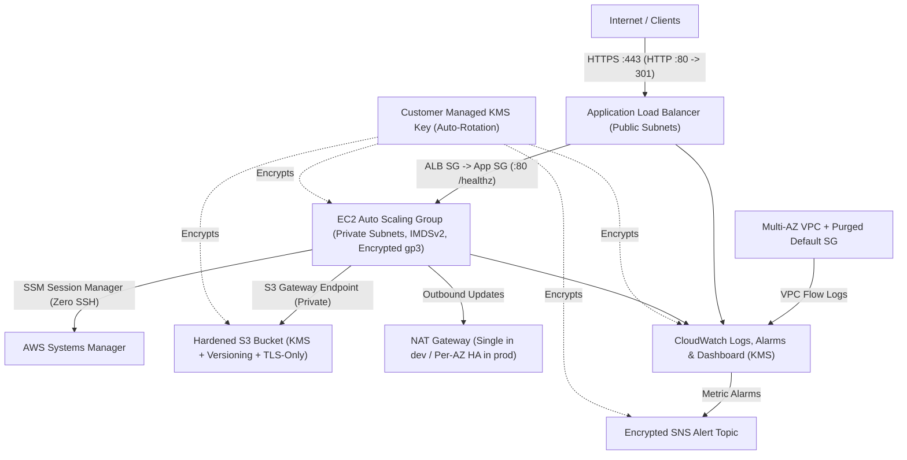
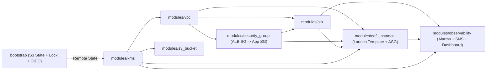
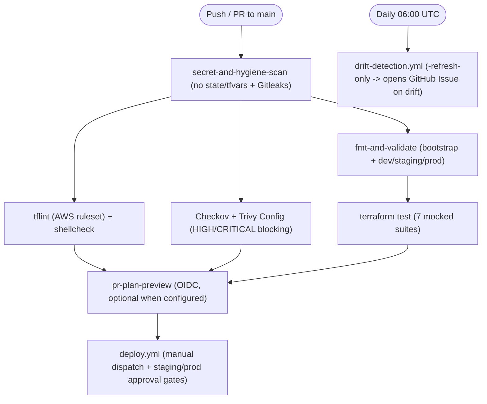

# aws-terraform-platform — Multi-Environment AWS Infrastructure Foundation

A production-grade, modular **Terraform (`>= 1.10`)** Infrastructure-as-Code platform for provisioning hardened, multi-AZ AWS environments (`dev`, `staging`, `prod`) with encrypted remote state, zero-SSH private compute, Application Load Balancing, CloudWatch observability, native `terraform test` suites, policy-as-code scanning, OIDC GitHub Actions CI/CD, and automated state backup/restore.

---

## Architecture Overview



### Module & Dependency Graph



---

## Environments & Estimated Monthly Cost

| Environment | Path | VPC CIDR | AZs | NAT Topology | Instance / ASG | ALB Protection | Log Retention | Est. AWS Cost (On-Demand) |
| --- | --- | --- | --- | --- | --- | --- | --- | --- |
| **dev** | `environments/dev` | `10.10.0.0/16` | 2 | Single NAT (toggleable) | `t3.micro` (1–2) | `false` | 14 days | ~\$58/mo (~\$25/mo if NAT disabled) |
| **staging** | `environments/staging` | `10.20.0.0/16` | 2 | Per-AZ HA NAT (2) | `t3.small` (2–4) | `false` | 30 days | ~\$125/mo |
| **prod** | `environments/prod` | `10.30.0.0/16` | 3 | Per-AZ HA NAT (3) | `t3.medium` (2–6) | `true` | 90 days | ~\$215/mo |

> [!TIP]
> Destroy non-production stacks (`make destroy ENV=dev`) whenever not actively demonstrating live AWS infrastructure. All formatting, validation, TFLint, Checkov, Trivy, and mocked `terraform test` checks run locally with **\$0 AWS spend**.

---

## Prerequisites

- **Terraform `1.10.5`** (pinned in [`.terraform-version`](.terraform-version))
- **AWS CLI v2** (only required for live AWS bootstrap/apply; not needed for local validation or mocked tests)
- *(Optional local linters)* **TFLint `0.54+`**, **Checkov**, **Trivy**, **ShellCheck**

---

## Quick Start — Validate & Test Locally (Zero AWS Account Required)

```bash
git clone https://github.com/Mahmoud6601/aws-terraform-platform.git
cd aws-terraform-platform

# Run format check, validation across bootstrap + dev/staging/prod, mocked terraform tests, and installed security scanners
./scripts/validate-all.sh

# Or run individual Make targets
make fmt
make validate
make test
```

---

## Live AWS Deployment Guide

### Step 1 — Bootstrap Remote State (One-Time Per AWS Account)

```bash
cd bootstrap
cp terraform.tfvars.example terraform.tfvars
# Edit terraform.tfvars and set a globally unique state_bucket_name
terraform init
terraform plan -out=tfplan
terraform apply tfplan
cd ..
```

### Step 2 — Configure Environment Backend & Variables

```bash
cp environments/dev/backend.hcl.example environments/dev/backend.hcl
cp environments/dev/terraform.tfvars.example environments/dev/terraform.tfvars
# Edit both gitignored files with your bootstrap bucket name and a unique artifacts_bucket_name
```

### Step 3 — Initialize, Plan & Apply

```bash
make init ENV=dev
make plan ENV=dev
make apply ENV=dev
```

### Step 4 — Verify Deployment

```bash
ALB_DNS="$(terraform -chdir=environments/dev output -raw alb_dns_name)"
curl -fsS "http://${ALB_DNS}/healthz"
# Expected: {"status":"ok","service":"aws-plat-dev","environment":"dev","instance_id":"i-...","az":"us-east-1a"}
```

Connect to any private EC2 instance without SSH keys or port 22 using **AWS SSM Session Manager**:

```bash
aws ssm start-session --target <instance-id>
```

---

## CI/CD & Drift Detection



---

## State Backup, Restore & Rollback

```bash
# Back up remote state before risky changes (writes gzipped state + SHA-256 into gitignored backups/)
./scripts/backup-state.sh dev

# Restore a verified state snapshot (prompts for confirmation; set RESTORE_FORCE=1 to bypass)
./scripts/restore-state.sh dev backups/dev/terraform-dev-YYYYMMDD-HHMMSSZ.tfstate.gz
```

**Infrastructure Rollback:** Revert the offending commit in Git (`git revert <sha>`), run `make plan ENV=<env>` to verify the exact diff, and apply cleanly. Never manually edit live AWS resources outside Terraform. Full recovery steps live in [`docs/RUNBOOK.md`](docs/RUNBOOK.md).

---

## Safe Teardown

```bash
make destroy ENV=dev
# In prod, first set alb_deletion_protection = false and s3_force_destroy = true only if intentionally decommissioning.
```

---

## Troubleshooting

| Symptom | Likely Cause | Fix |
| --- | --- | --- |
| `Error acquiring the state lock` | Interrupted apply or concurrent CI run | Confirm no active CI job is running, then inspect lock ID and run `terraform force-unlock <LOCK_ID>` (see `docs/RUNBOOK.md`) |
| `Error creating S3 Bucket: BucketAlreadyExists` | S3 bucket names are globally unique across AWS | Set a unique `artifacts_bucket_name` in your gitignored `terraform.tfvars` |
| `terraform validate` fails with provider error | Missing `-backend=false` during offline validation | Run `terraform init -backend=false` before `terraform validate` or use `./scripts/validate-all.sh` |
| Security Group validation fails on `0.0.0.0/0` | Built-in guardrail blocked unrestricted SSH (22) or RDP (3389) | Use AWS SSM Session Manager instead of SSH, or restrict CIDR to a private bastion/VPN range |

---

## Repository Structure

```text
.
├── .github/workflows/          # ci.yml, deploy.yml (OIDC + approvals), drift-detection.yml
├── bootstrap/                  # One-time encrypted S3 state bucket, DynamoDB lock table & OIDC role
├── modules/
│   ├── kms/                    # Rotating Customer Managed KMS Key
│   ├── vpc/                    # Multi-AZ VPC, IGW, NAT, S3 Endpoint, Flow Logs, locked default SG + tests
│   ├── security_group/         # Standalone SG rules, SG chaining & admin-port guardrails + tests
│   ├── s3_bucket/              # AWS Provider v5+ hardened S3 bucket + tests
│   ├── alb/                    # Hardened ALB, TLS 1.3, header drop, /healthz TG + tests
│   ├── ec2_instance/           # Private Launch Template + ASG, IMDSv2, encrypted gp3, SSM + tests
│   └── observability/          # Encrypted SNS, CloudWatch Log Groups, Alarms & Dashboard + tests
├── environments/
│   ├── dev/                    # Isolated dev root + mocked stack integration test
│   ├── staging/                # Isolated staging root
│   └── prod/                   # Isolated production root (3 AZs, HA NAT, deletion protection)
├── scripts/                    # backup-state.sh, restore-state.sh, validate-all.sh
├── docs/                       # ARCHITECTURE.md, DEPLOY.md, SECURITY.md, RUNBOOK.md
├── Makefile                    # Unified CLI targets
└── LICENSE                     # MIT License
```

## Documentation Suite

- [Architecture & Network Design](docs/ARCHITECTURE.md)
- [Deployment & Environment Promotion](docs/DEPLOY.md)
- [Security Controls & CIS Mapping](docs/SECURITY.md)
- [Day-2 Operations & Recovery Runbook](docs/RUNBOOK.md)

## Scope Boundaries

This repository intentionally focuses on AWS Infrastructure-as-Code, networking, security, observability, and delivery automation. The EC2 `user_data` Nginx `/healthz` endpoint is strictly a lightweight verification payload—not a production application.

## License

Licensed under the **MIT License** — see [`LICENSE`](LICENSE).
